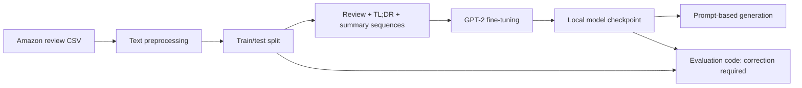

# GPT-2 Review Summarization

A notebook experiment in fine-tuning GPT-2 to generate short summaries of Amazon Fine Food Reviews using PyTorch and Hugging Face Transformers.

**Status:** the repository contains training and inference code, plus an evaluation implementation that needs correction. Historical ROUGE output is not presented as a reliable held-out benchmark because test inputs can include reference summaries and the batch evaluation scores only one item per batch.

## Why this project exists

Long reviews make it difficult to scan product feedback. This experiment explores adapting a pretrained causal language model to a review-to-summary task, covering text preparation, training, checkpoint saving and generation.

Originally developed for the CSE508 information retrieval coursework at IIIT Delhi.

## Architecture



This is a summarization experiment, without document retrieval, a vector index or a RAG pipeline.

## Engineering highlights

- Uses pretrained `GPT2LMHeadModel` and `GPT2Tokenizer` with a custom PyTorch dataset and data loaders.
- Preprocesses review text with HTML removal, lowercasing, tokenization and stopword removal.
- Implements an explicit training loop with AdamW, a linear learning-rate scheduler and CPU/CUDA selection.
- Saves model weights and includes prompt-based generation examples.
- Includes ROUGE evaluation code and a separate single-example BLEU calculation, with limitations documented below.

## Tech stack

| Area | Libraries |
| --- | --- |
| Model and training | PyTorch, Hugging Face Transformers |
| Data preparation | pandas, scikit-learn, Beautiful Soup, NLTK |
| Evaluation code | Hugging Face datasets, rouge-score, NLTK |
| Experiment environment | Jupyter notebook with Kaggle-specific paths |

## How it works

1. Read up to 40,000 reviews from the Amazon Fine Food Reviews CSV.
2. Prepare the review text and split rows into 75% training and 25% test data.
3. Tokenize `review TL;DR summary` sequences, padded/truncated to 70 tokens.
4. Train GPT-2 with next-token prediction using a configured batch size of 45, learning rate of `5e-5` and 10 epochs.
5. Save a local state dictionary and use a review followed by `TL;DR` as a generation prompt.

These are notebook configuration values, not performance or quality claims.

## Setup

```bash
git clone https://github.com/yashwant938/CSE508_Winter2024_A4_MT23107.git
cd CSE508_Winter2024_A4_MT23107
```

Open `CSE508_Winter2024_A4_MT23107..ipynb` in Jupyter or a notebook environment and review the following prerequisites before running cells:

- Obtain the Amazon Fine Food Reviews `Reviews.csv` dataset and update the `/kaggle/input/...` paths to its location. The generated dataset-import cell contains expired signed URLs; replace that cell with your environment's data-loading setup.
- Prepare the libraries listed above and the NLTK tokenizer/stopword resources. The notebook uses legacy `transformers.AdamW` and `datasets.load_metric` APIs; package versions or these imports need updating before a clean reproduction.
- Set the checkpoint save/load paths consistently. A trained `model.pt` checkpoint is not included in this repository.
- Correct evaluation before reporting metrics. A dependency lockfile and verified end-to-end run are still needed.

The repository is currently an experiment record, not a packaged training or inference service.

## Example

The notebook includes this generation prompt:

```text
you can buy the best things TL;DR
```

The generation cell tokenizes the prompt, loads the fine-tuned checkpoint, generates text and extracts the portion after `TL;DR`. No expected summary is asserted here; output depends on the trained checkpoint and generation settings.

## Engineering challenges

- **Evaluation leakage:** the test dataset encodes both review and reference summary. Generation must receive only the review and separator, while reference summaries stay separate for scoring.
- **Batch coverage:** the current loop decodes `outputs[0]` and scores `labels[0]` only. Every held-out example must be evaluated.
- **Loss and context handling:** training labels include padded tokens, and 70-token truncation can remove review context or the target summary. Padding masks and task-aware sequence construction need attention.
- **Reproducibility:** a later evaluation cell expects fields not returned by the dataset, and several paths and dependencies are environment-specific.

## Future improvements

- Separate training sequences, inference prompts and evaluation references.
- Mask padding in the training loss and review prompt/target token budgeting.
- Replace the broken evaluation paths with one consistent full-test-set evaluator.
- Add a summarization baseline and report metrics only after a reproducible evaluation run.
- Package configuration, dependencies, checkpoint metadata and inference into scripts with small tests.

